# ZAK-RBDO & ISORAK-RBDO

**Zeroth-order, adaptive-Kriging algorithms for Reliability-Based Design Optimization (RBDO).**

Research code of the PhD thesis:

> A. Faraci, *The use of machine learning and grey-box models to solve complex time-consuming RBDO
> problems*, Université Clermont Auvergne, 2025.

Implementation of *zeroth-order* optimization strategies (no gradients of the cost, of the constraints or of the failure
probabilities are needed), working with any simulation model.
- **ZAK-RBDO**: *Zeroth-order Adaptive Kriging RBDO*. A genetic algorithm drives the search, and
  Kriging surrogates of the limit-state functions are enriched only where the optimizer needs them.
- **ISORAK-RBDO**: *Isocost-constrained Regions Adaptive Kriging RBDO*. The same machinery, with
  the search and the enrichment confined to a cheap region of the design space that grows only if
  no reliable design is found inside it.

<p align="center">
  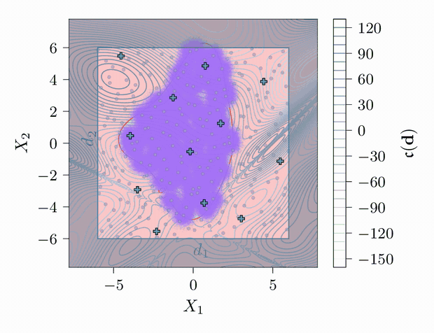
  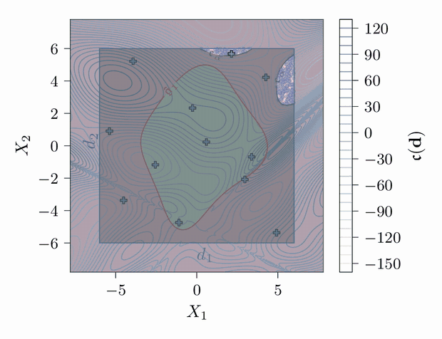
</p>
<p align="left"><sub>
ZAK-RBDO (left) and ISORAK-RBDO (right) on the four-branch benchmark. Red line: Kriging estimate
of the limit state; crosses: evaluations of the true limit-state function; purple cloud: Monte
Carlo population around the current best design; darkened area (right): designs outside the
current isocost region.
</sub></p>

## Contents

- [Problem statement](#problem-statement)
- [Installation](#installation)
- [Quick start](#quick-start)
- [Using the library from Python](#using-the-library-from-python)
- [Analyses](#analyses)
- [Configuration reference](#configuration-reference)
- [Outputs](#outputs)
- [Benchmarks](#benchmarks)
- [Adding your own problem](#adding-your-own-problem)
- [Project layout](#project-layout)
- [Citation](#citation)
- [License and acknowledgements](#license-and-acknowledgements)

## Problem statement

RBDO looks for the cheapest design whose probability of failure stays below a target:

```math
\boldsymbol{d}^* = \underset{\boldsymbol{d} \in \mathbb{D}}{\arg\min}\ \mathfrak{c}(\boldsymbol{d})
\quad \text{subject to} \quad
\begin{cases}
\mathfrak{f}_j(\boldsymbol{d}) \le 0, & j = 1, \dots, n_s \\
\mathbb{P}\left[\mathfrak{g}_k\big(\boldsymbol{X}(\boldsymbol{d}), \boldsymbol{Z}\big) \le 0\right] \le \overline{\mathcal{P}}_{f_k}, & k = 1, \dots, n_h
\end{cases}
```

| Symbol                             | Meaning                                                                                        | In the code               |
| ---------------------------------- | ---------------------------------------------------------------------------------------------- | ------------------------- |
| $`\boldsymbol{d}`$                 | design variables $`\in \mathbb{D}`$                                                            | `benchmark.bounds`        |
| $`\mathfrak{c}`$                   | cost function                                                                                  | `benchmark.cost`          |
| $`\mathfrak{f}_j`$                 | *soft* constraints: cheap, deterministic, satisfied when $`\mathfrak{f}_j \le 0`$              | `benchmark.soft`          |
| $`\mathfrak{g}_k`$                 | *hard* constraints: expensive limit-state functions, failure when $`\mathfrak{g}_k \le 0`$     | `benchmark.hard`          |
| $`\boldsymbol{X}(\boldsymbol{d})`$ | random design variables, whose distribution depends on $`\boldsymbol{d}`$                      | `benchmark.get_W`         |
| $`\boldsymbol{Z}`$                 | environmental random variables, independent of $`\boldsymbol{d}`$                              | `benchmark.get_W`         |
| $`\overline{\mathcal{P}}_{f_k}`$   | target failure probability ($`\overline{\beta}_k = -\Phi^{-1}(\overline{\mathcal{P}}_{f_k})`$) | `Pf_thr` in the YAML file |

The surrogates are built in the **augmented space** $`\mathbb{V} = \mathbb{X}(\mathbb{D}) \times \mathbb{Z}`$, which covers every value the random variables can take for any admissible design.

<p align="center">
  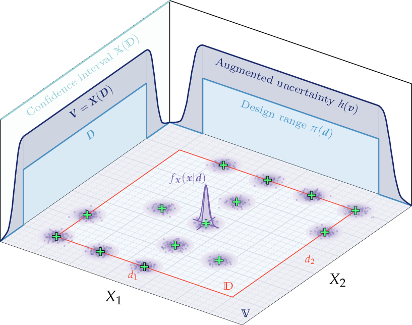
</p>

## Installation

Requirements:

- **Python ≥ 3.13**.
- **A LaTeX distribution** (TeX Live, MacTeX, MiKTeX) with `amsmath`, `amssymb`, `bm` and
  `physics`. Importing `zak` configures Matplotlib with `text.usetex = True`. 
- Optional, only to assemble the evolution frames into videos: **ImageMagick**, **ffmpeg** and
  `bash`.

With [uv](https://docs.astral.sh/uv/) (recommended):

```bash
git clone https://github.com/alefaraci/zak-isorak-rbdo.git
cd zak-isorak-rbdo
uv sync
source .venv/bin/activate
```

With pip:

```bash
git clone https://github.com/alefaraci/zak-isorak-rbdo.git
cd zak-isorak-rbdo
python -m venv .venv
source .venv/bin/activate
pip install -e .
```

The main dependencies are [PyTorch](https://pytorch.org), [BoTorch](https://botorch.org) /
[GPyTorch](https://gpytorch.ai) (Kriging), [EvoTorch](https://evotorch.ai) (genetic algorithm),
[OpenTURNS](https://openturns.github.io/www/) (iso-probabilistic transformations),
[scikit-learn](https://scikit-learn.org) (DBSCAN), [Polars](https://pola.rs) and [Matplotlib](https://matplotlib.org).

## Quick start

The `examples/` folder contains everything needed to run the benchmarks: a launcher,
a post-processing script, one YAML file per benchmark and a shared `settings.yaml`.

With the virtual environment activated, run ZAK-RBDO on the four-branch benchmark:

```bash
python examples/run.py --analysis zakrbdo --benchmark four_branches --seed 27
```

A live panel shows the generation counter, the best design, its failure probability, the surrogate
error and the number of limit-state evaluations.

Then generate the figures:

```bash
python examples/postprocess.py --analysis zakrbdo --benchmark four_branches
```

Output is written under `examples/results/zakrbdo/four_branches/<timestamp>_seed27/`
(see [Outputs](#outputs)).

> [!IMPORTANT]
> The population is evaluated in parallel by [Ray](https://www.ray.io)
> actors. When the launcher is started with `uv run`, Ray tries to recreate the uv environment in
> its workers and stops because the scripts change the working directory to `examples/`. Either
> use the activated environment as above, or disable that integration:
> `RAY_ENABLE_UV_RUN_RUNTIME_ENV=0 uv run python examples/run.py ...`.

Command-line options of `run.py`:
| Option | Values | Default |
|---|---|---|
| `--analysis` | `ddo`, `rbdo`, `zakrbdo`, `isorakrbdo` | required |
| `--benchmark` | name of a `<benchmark>.yaml` file in `examples/` | required |
| `--seed` | integer random seed | `27` |

Command-line options of `postprocess.py`:

| Call | Effect |
|---|---|
| `--analysis A --benchmark B --timestamp T` | plots, evolution frames and videos for one run (`T` is the run folder name, e.g. `2025_06_24_235730_seed27`) |
| `--analysis A --benchmark B` | plots for every run of the benchmark, animations for the first one, plus box plots and a table of median results across seeds |
| `--analysis A` | the same for every benchmark of the analysis |

To compare ZAK-RBDO and ISORAK-RBDO:

```bash
python examples/postprocess_comparison.py --benchmark four_branches
```

> [!TIP]
> `EVOTORCH_VERBOSE_LEVEL=0` silences EvoTorch's own messages,
and `PYTORCH_ENABLE_MPS_FALLBACK=1` is required when `device: "mps"` is selected.

## Using the library from Python

The launcher is a wrapper around three objects:

```python
import os
from pathlib import Path

from zak import utils
from zak.loggers import PolarsLogger
from zak.problem import OptimizationProblem
from zak.searcher.ga import GeneticAlgorithmSearcher

# The problem reads `<benchmark_id>.yaml` and `settings.yaml` from the working directory.
os.chdir("examples")

problem = OptimizationProblem(analysis="zakrbdo", benchmark_id="four_branches", seed=27)
searcher = GeneticAlgorithmSearcher(problem)
logger = PolarsLogger(searcher)

output = Path("results/my_run")
output.mkdir(parents=True, exist_ok=True)
with utils.live:  # live console panel
    searcher.run(logger=logger, path=output)

history = logger.postprocess_dataframe()  # one row per generation (Polars DataFrame)
print(history["pop_best"][-1], history["Pf"][-1], history["g_calls"][-1])
logger.save(output / "results.json")  # the same table, as NDJSON
```

- `OptimizationProblem` (EvoTorch `Problem`) loads the benchmark, estimates the failure
  probabilities of every individual by quasi-Monte Carlo and turns cost and constraint violations
  into a fitness value.
- `GeneticAlgorithmSearcher` (EvoTorch `GeneticAlgorithm`) evolves the population and, for the
  Kriging-based analyses, builds and enriches the surrogates.
- `PolarsLogger` records one row per generation.

>[!IMPORTANT]
> ISORAK-RBDO needs an outer loop that enlarges the isocost region between two searches; it is
implemented in `isocost_analysis()` in [`examples/run.py`](examples/run.py).

## Analyses

| `--analysis` | What it does                                                                                                                                                                         | Limit-state evaluations                                        |
| ------------ | ------------------------------------------------------------------------------------------------------------------------------------------------------------------------------------ | -------------------------------------------------------------- |
| `ddo`        | Deterministic design optimization: constraints are checked at the design point only (not maintained).                                                                                | true model                                                     |
| `rbdo`       | Brute-force RBDO: failure probabilities are estimated by quasi-Monte Carlo on the true limit states for every individual. Reference solution, only affordable for analytical models. | true model, ~10⁸ calls                                         |
| `zakrbdo`    | ZAK-RBDO.                                                                                                                                                                            | Kriging surrogates, enriched adaptively                        |
| `isorakrbdo` | ISORAK-RBDO.                                                                                                                                                                         | Kriging surrogates, enriched adaptively inside isocost regions |

## Configuration reference

Each benchmark has a `<benchmark>.yaml` file with one top-level section per analysis (`DDO`,
`RBDO`, `ZAKRBDO`, `ISORAKRBDO`). The section of `four_branches.yaml` used by ZAK-RBDO is:

```yaml
ZAKRBDO:
  gp:
    covar_module: ["MaternKernel"]
    batch_train_set: 12
    size_candidate_global: 1e6
    rho_thr: 0.99
    eps_max_thr: 0.01

  DBSCAN:
    min_samples: 2
    eps: 2.8

  rbdo:
    batch_qmc: 5e4
    size_mc: 5e5
    Pf_thr: [1.358e-3]
    CoV_thr: [0.05, 0.05]

  ga:
    n_gen: 500
    n_ind: 64
    tournament_size: 4
    stdev: [1.0, 1.0]
    mutation_probability: 0.2
    cross_over_rate: 0.8
    window: 35
    improvement_max: 0.001
```

**`ga` — genetic algorithm** (all analyses)

| Key | Meaning |
|---|---|
| `n_gen` | Maximum number of generations. |
| `n_ind` | Population size. |
| `tournament_size` | Number of individuals competing in each tournament selection. |
| `stdev` | Initial standard deviation of the Gaussian mutation, one value per design variable. It shrinks as the generations go by. |
| `mutation_probability` | Probability that a design variable of an offspring is mutated. |
| `cross_over_rate` | Probability of applying two-point crossover to a pair of parents. |
| `window` | Number of generations $`\omega`$ over which stagnation is measured. |
| `improvement_max` | Convergence threshold: the search has stagnated when the normalized change of the best and median fitness over the last `window` generations falls below this value. |
| `alpha_init` | *ISORAK-RBDO only.* Level $`\alpha`$ of the first isocost region, i.e. the fraction of the design domain (ranked by cost) that is initially explored. |

**`rbdo` — reliability analysis** (`rbdo`, `zakrbdo`, `isorakrbdo`)

| Key | Meaning |
|---|---|
| `Pf_thr` | Target failure probability $`\overline{\mathcal{P}}_{f_k}`$, one value per limit state (`1.358e-3` ↔ $`\overline{\beta} = 3`$, `2.275e-2` ↔ $`\overline{\beta} = 2`$). |
| `batch_qmc` | Number of quasi-Monte Carlo samples used to estimate the failure probabilities of each individual. |
| `size_mc` | Size of the Monte Carlo population used around the best design for the AK-MCS refinement and for the final verification. |
| `CoV_thr` | Target coefficient of variation of the Monte Carlo estimate of $`\mathcal{P}_f`$, reported in the final verification table. |

**`gp` — Kriging surrogates** (`zakrbdo`, `isorakrbdo`)

| Key                     | Meaning                                                                                                                                                                   |
| ----------------------- | ------------------------------------------------------------------------------------------------------------------------------------------------------------------------- |
| `covar_module`          | Covariance kernel, one per limit state.                                                                                                                                   |
| `batch_train_set`       | Size of the initial Sobol DoE in the augmented space.                                                                                                                     |
| `size_candidate_global` | Number of candidate designs $`\mathcal{S}^{(g)}`$ sampled over the design domain for the global enrichment.                                                               |
| `rho_thr`               | Global accuracy threshold $`\rho_{th}`$: global enrichment stops when this fraction of the candidates is classified with $`\mathrm{U} > 2`$.                              |
| `eps_max_thr`           | Threshold $`\varepsilon_{th}`$ of the error-based stopping criterion (ESC): maximum relative error on $`\mathcal{P}_f`$ at the best design tolerated from the surrogates. |

**`DBSCAN` — sparsity filter on new training points** (`zakrbdo`, `isorakrbdo`)

| Key | Meaning |
|---|---|
| `eps` | Neighbourhood radius $`\varrho`$, measured in the standard normal space. |
| `min_samples` | Minimum number of neighbours for a point to belong to a cluster. A candidate that would fall inside a cluster of existing training points is rejected. |

**`settings.yaml` — shared by all benchmarks**

| Key | Meaning |
|---|---|
| `dtype` | `"float16"`, `"float32"` or `"float64"`. |
| `device` | `"cpu"`, `"cuda"` or `"mps"`. |
| `num_actors` | Number of Ray actors evaluating the population in parallel (`1` disables parallel evaluation). |
| `subbatch_size` | Maximum number of individuals sent to an actor at once (`null`: one equal share per actor). |
| `num_gpus_per_actor` | Fraction of a GPU reserved for each actor (`null`: none). |

## Outputs

`run.py` creates `examples/results/<analysis>/<benchmark>/<timestamp>_seed<seed>/` with:

| File | Content |
|---|---|
| `results.json` | NDJSON, one row per generation (columns below). |
| `opt_problem.pickle` | The `OptimizationProblem`, including the trained surrogates. Needed by the post-processing. |
| `analysis.log` | Copy of the console output. |

Columns of `results.json`:

| Column | Content |
|---|---|
| `iter` | Generation number. |
| `pop_best` | Best design of the generation. |
| `pop_best_eval`, `median_eval`, `mean_eval` | Best, median and mean fitness of the population. |
| `individuals` | The whole population. |
| `Pf`, `Beta` | Failure probability and reliability index of the best design, one value per limit state (`rbdo`, `zakrbdo`, `isorakrbdo`). |
| `feasibility` | Whether the best design satisfies every constraint. |
| `eps_max` | ESC estimate of the maximum relative error on $`\mathcal{P}_f`$ due to the surrogates (`zakrbdo`, `isorakrbdo`). |
| `g_calls` | Cumulative number of evaluations of each true limit-state function (`zakrbdo`, `isorakrbdo`). |
| `doe` | Training points of each surrogate (`zakrbdo`, `isorakrbdo`). |
| `alpha` | Level $`\alpha`$ of the isocost region explored at that generation (`isorakrbdo`). |
| `pop_init_alpha` | Initial population of the search in the current isocost region (`isorakrbdo`). |

`postprocess.py` adds to the run folder:

- `pdf/`: evolution of the cost, of the design variables, of the fitness, of $`\mathcal{P}_f`$ and
  $`\beta`$, of `eps_max` and of the number of limit-state calls; the optimal design drawn over the
  benchmark, with its quasi-Monte Carlo and Monte Carlo sample clouds; the history of the best
  design;
- `evolution/<type>/frame_XXXX.pdf`: one frame per generation (`evo_g_space`: design space,
  `evo_g_aug_space`: augmented space), and a `.mov` video per frame type when ImageMagick and
  ffmpeg are available;
- `postprocess.log`: summary tables (optimal design, Monte Carlo verification on the surrogates and
  on the true limit states).

At the benchmark level it writes `box_plot_*.pdf` and `median_results.log`, which summarize all the
seeds available. `postprocess_comparison.py` writes its box plots to
`examples/results/comparison/<benchmark>/`.

<p align="center">
  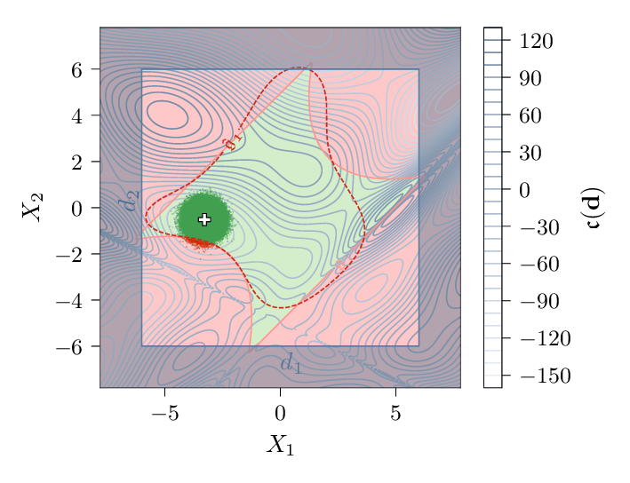
  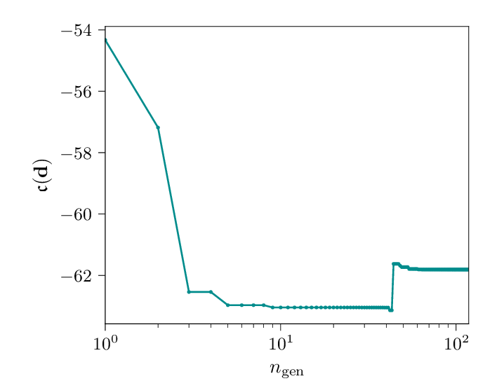
  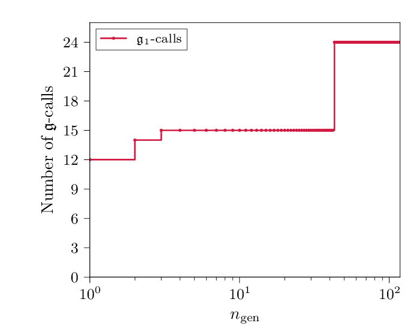
</p>
<p align="left"><sub>
ZAK-RBDO run on the four-branch benchmark: optimal design with
its Monte Carlo population, cost of the best design and cumulative number of limit-state calls
versus the generation number.
</sub></p>

## Benchmarks

Twelve problems are registered in `zak.benchmarks.register_benchmark`; the benchmark id is the name
passed to `--benchmark`.

| id | Problem | Design variables | Random variables | Constraints |
|---|---|---|---|---|
| `four_branches` | Four-branch series system with a (scaled) Eggholder cost | 2 | $`X_i \sim \mathcal{N}(d_i, 0.3)`$ | 1 hard |
| `highly_nonlinear` | Highly nonlinear analytical problem | 2 | $`X_i \sim \mathcal{N}(d_i, 0.1)`$ | 2 hard |
| `three_nonlinear` | Analytical problem with three nonlinear limit states | 2 | $`X_i \sim \mathcal{N}(d_i, 0.3)`$ | 3 hard |
| `column_under_compression` | Elastic column under compression (Euler buckling), cross-section $`b \times h`$ | 2 | 3 log-normal environmental variables | 1 hard, 1 soft |
| `bracket_structure` | Two-member bracket, minimum weight | 3 | 3 design + 5 environmental variables | 2 hard |
| `truss_bridge` | Truss bridge, minimum volume, mid-span deflection limit | 2 | 2 design + 8 environmental variables | 1 hard |
| `linear_stackup` | Tolerance allocation on a linear stack-up of two parts | 2 tolerances | 2 dimensions | 2 hard |
| `linear_stackup_mean_shift` | Same, with a mean shift of the manufacturing process | 2 tolerances | 2 dimensions | 2 hard |
| `cantilever_2d` | Tolerance design of a cantilever beam: nominal values and tolerances of 2 dimensions | 4 | 2 dimensions | 3 hard, 4 soft |
| `cantilever_2d_mean_shift` | Same, with a mean shift | 4 | 2 dimensions | 3 hard, 4 soft |
| `cantilever_4d` | Tolerance design of a cantilever beam: nominal values and tolerances of 4 dimensions | 8 | 4 dimensions | 3 hard, 8 soft |
| `cantilever_4d_mean_shift` | Same, with a mean shift | 8 | 4 dimensions | 3 hard, 8 soft |

<p align="center">
  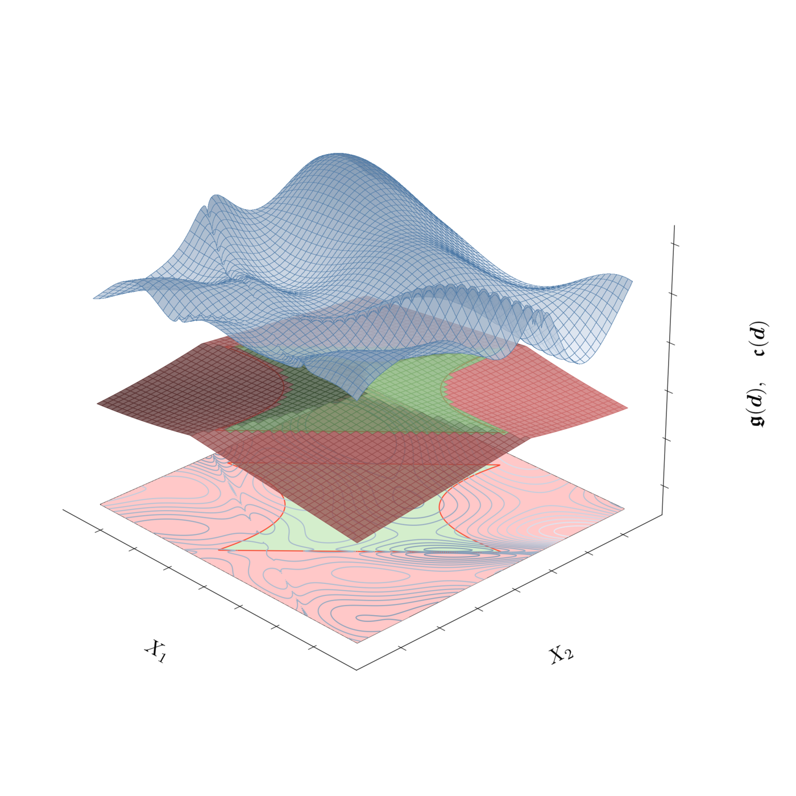
  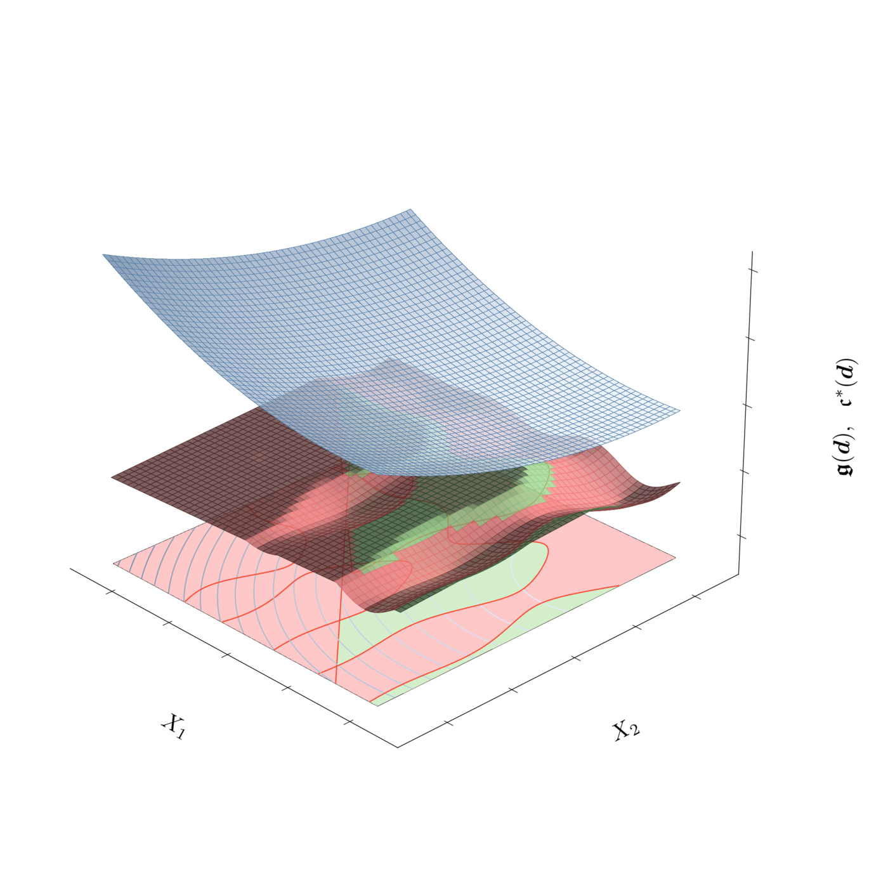
  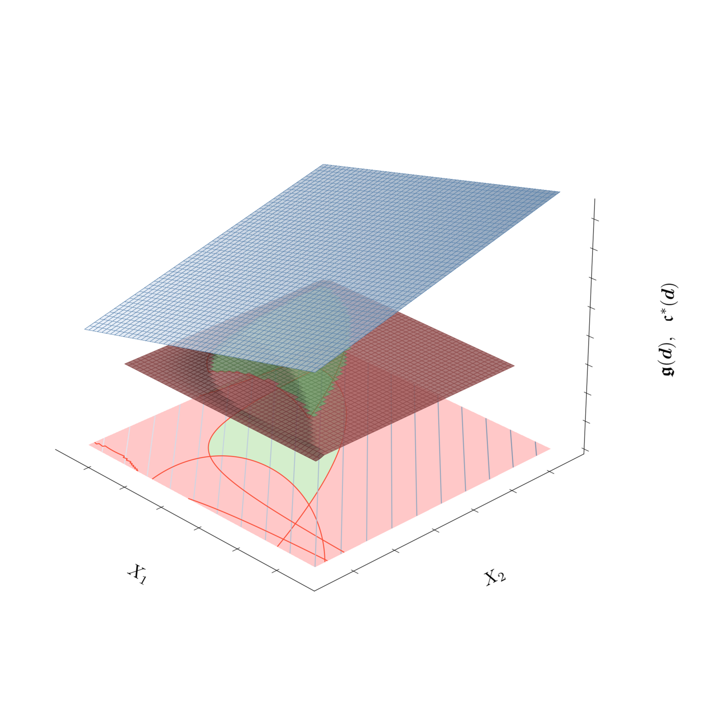
</p>
<p align="left"><sub>
Four-branch, highly nonlinear and three-nonlinear benchmarks: cost surface (blue), limit-state
surface (red: failure, green: safe) and their projection on the design space.
</sub></p>

<p align="center">
  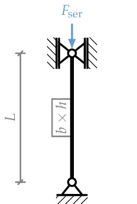
  &nbsp;&nbsp;
  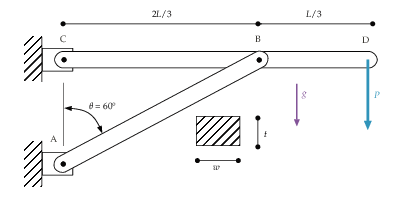
  &nbsp;&nbsp;
  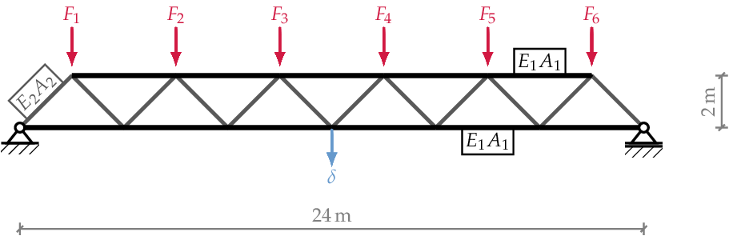
</p>
<p align="center">
  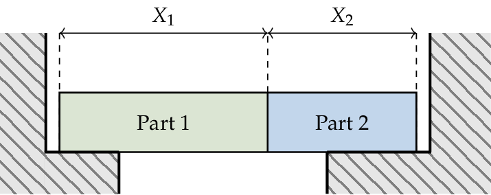
</p>
<p align="left"><sub>
Structural and tolerancing benchmarks: column under compression, two-member bracket, truss bridge
and linear stack-up.
</sub></p>

## Adding your own problem

1. **Cost function.** In [`src/zak/test_functions/cost.py`](src/zak/test_functions/cost.py),
   subclass `CostFunction` and implement `fn(X)`, which maps a tensor of designs of shape
   `(..., dim)` to their cost.
2. **Limit states.** In [`src/zak/test_functions/hard.py`](src/zak/test_functions/hard.py),
   subclass `HardConstraint` and implement `fn(X)` on points of the augmented space. Failure is
   $`\mathfrak{g} \le 0`$. This is where an external simulator would be called.
3. **Soft constraints** (optional). In [`src/zak/test_functions/soft.py`](src/zak/test_functions/soft.py),
   subclass `SoftConstraint`; the constraint is satisfied when `fn(X) <= 0`.
4. **Benchmark.** In [`src/zak/benchmarks/base.py`](src/zak/benchmarks/base.py), subclass
   `BenchmarkBase` and provide:
   - `id`, `dim`, `cost`, `hard`, `soft`;
   - `bounds` (design domain), `aug_bounds` (bounds of the augmented space, used to normalize the
     surrogate inputs and to draw the initial design of experiments) and `min_max` (minimum and
     maximum of the cost over the design domain, used to normalize it);
   - `get_W(N_SAMPLES, design)`: quasi-Monte Carlo samples of the random variables for each design;
   - `get_W_MCS(N_SAMPLES, design)`: crude Monte Carlo samples for the final verification;
   - `get_probabilistic_model(design)`: the same joint distribution as an OpenTURNS object, used to
     map points to the standard normal space for the DBSCAN filter.

   `HighlyNonlinear` is the simplest complete example.
5. **Registration.** Add the class to the `register_benchmark` dictionary at the bottom of the
   file.
6. **Configuration.** Create `<id>.yaml` next to your launcher, starting from one of the files in
   `examples/`.

The 2D plots and animations of the post-processing are enabled per benchmark id in the `plotting`
dictionary of [`src/zak/plotter/postprocess.py`](src/zak/plotter/postprocess.py); the evolution
curves and the summary tables work for any problem.

## Project layout

```
├── examples/                  launcher, post-processing and one YAML file per benchmark
│   ├── run.py
│   ├── postprocess.py
│   ├── postprocess_comparison.py
│   ├── run_animator.sh        PDF frames -> video (ImageMagick + ffmpeg)
│   ├── settings.yaml
│   └── <benchmark>.yaml
├── src/zak/
│   ├── benchmarks/            BenchmarkBase, the 12 benchmarks and their registry
│   ├── test_functions/        cost functions, hard (limit-state) and soft constraints
│   ├── problem/               OptimizationProblem (fitness, reliability analysis), ESC criterion
│   ├── searcher/              genetic algorithm, enrichment strategies, DBSCAN filter, convergence
│   ├── gaussianprocess/       Kriging surrogates (BoTorch / GPyTorch)
│   ├── random_vars/           Sobol design of experiments
│   ├── loggers/               per-generation logging (Polars) and console output
│   ├── plotter/               figures, animations, box plots
│   └── utils/                 console, YAML and pickle I/O, argument parsing
└── docs/images/               figures used in this README
```

## Citation

If you use this code, please cite the thesis:

```bibtex
@phdthesis{faraci2025rbdo,
  author = {Faraci, Alessio},
  title  = {The use of machine learning and grey-box models to solve complex time-consuming {RBDO} problems},
  school = {Universit{\'e} Clermont Auvergne},
  year   = {2025}
}
```

Related publications:

```bibtex
@inproceedings{faraci2023unified,
  author    = {Faraci, Alessio and Beaurepaire, Pierre and Gayton, Nicolas},
  title     = {An Unified Enrichment Strategy for Reliability-Based Design Optimization using Adaptive Kriging and Zero-order Algorithms},
  booktitle = {5th International Conference on Uncertainty Quantification in Computational Sciences and Engineering (UNCECOMP 2023)},
  pages     = {478--485},
  year      = {2023},
  doi       = {10.7712/120223.10351.19782}
}

@inproceedings{faraci2024enhancing,
  author    = {Faraci, Alessio and Beaurepaire, Pierre and Gayton, Nicolas},
  title     = {Enhancing Reliability-Based Design Optimization through Adaptive Kriging and gradient-free optimization},
  booktitle = {10th International Conference on Uncertainty in Structural Dynamics (USD 2024)},
  year      = {2024}
}

@misc{faraci2024isocost,
  author = {Faraci, Alessio and Moustapha, Maliki and Marelli, Stefano and Beaurepaire, Pierre and Sudret, Bruno and Gayton, Nicolas},
  title  = {An iso-cost-region enrichment strategy for cost-free Reliability-Based Design Optimization},
  note   = {Engineering Mechanics Institute Conference and Probabilistic Mechanics \& Reliability Conference (EMI/PMC 2024), Chicago, IL, USA},
  year   = {2024}
}
```

## License and acknowledgements

Released under the [MIT License](LICENSE). Copyright © 2023–2025 Alessio Faraci.

This project has received funding from the European Union’s Horizon 2020 research and innovation
programme under the Marie Skłodowska-Curie grant agreement No. 955393.
